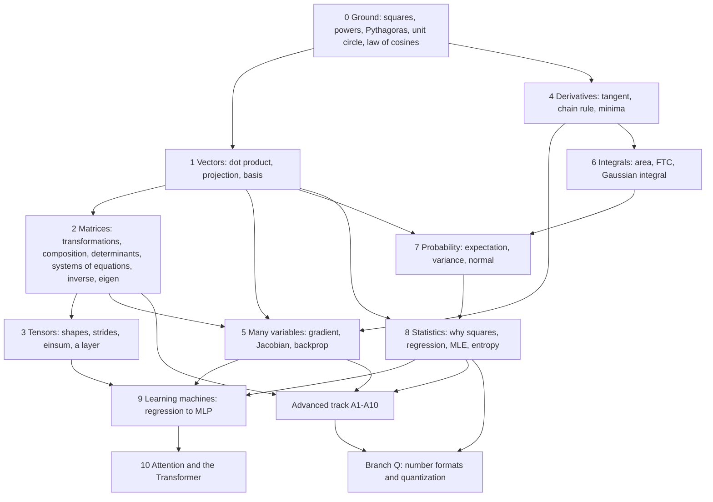

# Curriculum — Math for AI

Single source of truth for the course structure until it is moved into `src/data/course.json` + `terms.json`.
Rule: **every lesson answers the question the previous lessons left open**, and ends with the next open question.
Columns: `built on` = hard prerequisites (edges of the step map); `→ leaves open` = the hook into the next lesson.

The spine in one sentence: *measure distance (Pythagoras) → measure angle (law of cosines) → arrows (vectors)
→ compare arrows (dot product) → move all arrows at once (matrices) → stack many arrows (tensors) → a layer
`y = xWᵀ + b` → how wrong is W (loss) → how to change W (derivatives, gradient) → why this loss (probability,
statistics, "why squares") → train machines (regression → MLP) → attention, built only from parts we already own.*

## Part 0 — Ground

| id | lesson | built on | → leaves open |
|---|---|---|---|
| 0.G | Ground: squares are areas, roots undo them, a point is two readings on two rulers (merged 0.1 + 0.2; slope moved to 4.1) | — | what do x^3, x^0, x^-1, x^(1/2) mean? |
| 0.2 | **Powers**: whole (repeated multiplication: length, area, volume), zero (x^0 = 1), negative (repeated division: halving tiles), fractional (x^(1/2) = side of a square of area x, x^(1/3) = edge of a cube); one rule x^m x^n = x^(m+n) explains them all | 0.G | how far apart are two points? |
| 0.3 | Distance and Pythagoras (2D → 3D → n-D) | 0.G | how to describe a direction, not just a distance? |
| 0.4 | Angles, radians, the unit circle: cos and sin are coordinates | 0.3 | what if the triangle has no right angle? |
| 0.5 | Law of cosines = Pythagoras + a correction term; CG anchor: two-bone IK | 0.3, 0.4 | treat the sides as arrows → vectors |

## Part 1 — Vectors

| id | lesson | built on | → leaves open |
|---|---|---|---|
| 1.1 | A vector: an arrow and a list of numbers; point vs direction (position vs normal in CG) | 0.3 | what can we do with arrows? |
| 1.2 | Adding and scaling; linear combinations | 1.1 | how long is an arrow in n dimensions? |
| 1.3 | Length, Σ notation, normalization (Pythagoras in n-D) | 1.2, 0.3 | how to measure the angle between arrows? |
| 1.4 | **Dot product derived from the law of cosines**: Σaᵢbᵢ = \|a\|\|b\|cos θ | 1.3, 0.5 | what does the number *mean* geometrically? |
| 1.5 | **Projection**: shadows on an axis; coordinates are dot products with basis vectors | 1.4 | which axes can we use? |
| 1.6 | Basis, span, linear independence, dimension; change of basis for orthonormal bases only (general case needs the inverse, 2.9) | 1.2, 1.5 | can meaning be an arrow? |
| 1.7 | Cosine similarity and embeddings (words/images as vectors) | 1.4, 1.6 | how to move *all* arrows at once? |
| 1.8 | Cross product — side branch (normals, area, orientation); dashed edge to 2.6 | 1.4 | volume and orientation return in 2.6 |
| 1.9 | **Waves as vectors: the DFT is a list of dot products** — a sampled signal is a vector; each frequency is a cosine/sine "ruler"; the dot product with it measures how much the signal points in that frequency's direction; these rulers are orthogonal, so the DFT is a change to an orthogonal basis and the inverse rebuilds the signal (real cos/sin form, no complex numbers yet); FFT = the same numbers computed fast (preview, full treatment in A4) | 1.4, 1.5, 1.6, 0.4 | can a matrix do all those dot products at once? |

## Part 2 — Matrices

| id | lesson | built on | → leaves open |
|---|---|---|---|
| 2.1 | Linear transformations: grid lines stay straight, origin stays put; decided by where the basis lands | 1.6 | how to write that down? |
| 2.2 | **Matrix = images of basis vectors as columns**; M·v = combination of columns = dot products of rows | 2.1, 1.4 | which shapes of motion exist? |
| 2.3 | Gallery: scale, rotate, shear, reflect, project; homogeneous 4×4 and translation (= bias in AI) | 2.2, 0.4 | what if we apply two in a row? |
| 2.4 | **Matrix × matrix = composition**; 4 views: row·column, column combos, composition, 3D cube; AB ≠ BA | 2.2, 2.3 | what does flipping a matrix mean? |
| 2.5 | Transpose; aᵀb as a 1-row matrix product; ⟨Ax, y⟩ = ⟨x, Aᵀy⟩ | 2.4, 1.4 | how much does a matrix stretch space? |
| 2.6 | Determinant: area/volume scale, sign = orientation, det 0 = squashing | 2.3, 1.8 | how do we get the number without drawing? |
| 2.7 | Computing determinants: 2x2 as a parallelogram, 3x3 (cofactors, Sarrus), row operations, det(AB) = det A det B | 2.6, 2.4 | what is det good for besides area? |
| 2.8 | **Systems of linear equations**: row picture (lines/planes meet) vs column picture (columns combine to hit b); 0 / 1 / infinitely many solutions; Gaussian elimination step by step; Cramer's rule as a ratio of areas | 2.7, 1.2 | can we undo A once and reuse it? |
| 2.9 | Inverse and solving Ax = b: Gauss-Jordan, "solve, don't invert", conditioning (nearly-flat det) | 2.8, 2.4 | what exactly gets lost when we can't? |
| 2.10 | Rank, column space, null space | 2.9, 1.6 | are there directions a matrix only stretches? |
| 2.11 | Eigenvectors and eigenvalues: det(A - lambda I) = 0; diagonalization = the best basis | 2.10, 2.7, 1.6 | real data have more than 2 axes -> tensors |

## Part 3 — Tensors

| id | lesson | built on | → leaves open |
|---|---|---|---|
| 3.1 | The rank ladder: scalar → vector → matrix → cube → stack of cubes; shape and axes | 2.2 | what real data look like this? |
| 3.2 | Data as tensors: image H×W×C, batch, text B×T×D (tokens → embeddings) | 3.1, 1.7 | where do these numbers live in memory? |
| 3.3 | Memory: flat buffer, strides, reshape / view / transpose / contiguous (machine layer) | 3.1 | how to compute with whole tensors? |
| 3.4 | Elementwise ops and broadcasting | 3.3 | how to collapse an axis? |
| 3.5 | Reductions: sum, mean, max along an axis (mean seeds statistics) | 3.4 | how to multiply tensors? |
| 3.6 | Batched matmul and einsum: contraction over a shared index | 2.4, 3.5 | what is a neural layer, then? |
| 3.7 | **A layer: y = xWᵀ + b over a batch**, plus ReLU | 3.6, 2.3 | how wrong is W, and how to fix it? |

## Part 4 — Change: derivatives

| id | lesson | built on | → leaves open |
|---|---|---|---|
| 4.1 | The line y = kx + b and its slope; rate of change: average slope (secant) | 0.G | the slope *at a point*? |
| 4.2 | Limit (intuitively) and derivative = tangent: zoom until the curve is straight | 4.1 | computing them without zooming? |
| 4.3 | Rules: power, sum, product; (x²)′ = 2x | 4.2 | which function is its own derivative? |
| 4.4 | eˣ and ln: growth, logs turn products into sums | 4.3 | derivatives of nested functions? |
| 4.5 | Chain rule (composition again, as in 2.4) | 4.3, 4.4 | where is a function smallest? |
| 4.6 | Minima and maxima; the mean minimizes Σ(x−c)² (first glimpse of "why squares") | 4.5, 3.5 | how good is a straight-line approximation? |
| 4.7 | Linear approximation and Taylor; finite differences vs float rounding (machine) | 4.2, 4.6 | functions of many inputs? |

## Part 5 — Many variables

| id | lesson | built on | → leaves open |
|---|---|---|---|
| 5.1 | Functions of many variables: surfaces and contour lines | 4.2, 1.1 | slope along one axis? |
| 5.2 | Partial derivatives | 5.1 | the slope in *any* direction? |
| 5.3 | **Gradient**: directional derivative = ∇f · u; steepest ascent, ⟂ to contours | 5.2, 1.4 | vector-valued functions? |
| 5.4 | **Jacobian = the local matrix**: zoom a warped grid until it is linear; chain rule = product of Jacobians | 5.3, 2.4, 4.5 | how to walk downhill? |
| 5.5 | Gradient descent: step size, divergence, a ball on the loss surface | 5.3, 4.6 | gradients of huge formulas, efficiently? |
| 5.6 | Computation graphs and backpropagation (reverse mode) | 5.4, 5.5 | adding up infinitely many small pieces? |

## Part 6 — Accumulation: integrals

| id | lesson | built on | → leaves open |
|---|---|---|---|
| 6.1 | Area under a curve: Riemann sums | 4.1, 3.5 | a shortcut instead of summing? |
| 6.2 | Fundamental theorem: integral and derivative undo each other | 6.1, 4.3 | which functions can we integrate? |
| 6.3 | Antiderivative table + numeric integration (machine) | 6.2, 4.4 | more than one variable? |
| 6.4 | Double integrals and volume; the Gaussian integral √π | 6.3, 5.1 | how to describe uncertainty? |

## Part 7 — Probability

| id | lesson | built on | → leaves open |
|---|---|---|---|
| 7.1 | Events and probability: sum and product rules, conditional probability | 0.G | reversing a condition? |
| 7.2 | Bayes' rule | 7.1 | numbers that are random? |
| 7.3 | Random variables: PMF and density (density needs integrals) | 7.1, 6.2 | the "typical" value? |
| 7.4 | Expectation = probability-weighted average (a dot product of values and probabilities) | 7.3, 1.4 | how spread out is it? |
| 7.5 | Variance and standard deviation — here the "why squares" question is posed | 7.4, 4.6 | which shapes do distributions take? |
| 7.6 | Bernoulli, categorical, uniform, normal (e^(−x²)) | 7.3, 6.4, 4.4 | why is the normal one everywhere? |
| 7.7 | Law of large numbers and the central limit theorem (simulated) | 7.5, 7.6 | how to learn from data? |

## Part 8 — Statistics: why squares everywhere

| id | lesson | built on | → leaves open |
|---|---|---|---|
| 8.1 | Data as vectors; centering = removing the all-ones direction (a projection) | 1.5, 3.5, 7.4 | the right measure of error? |
| 8.2 | **Why squares I**: distance (Pythagoras), smooth parabola, the mean as the minimizer, vs \|x\| and the median | 8.1, 0.3, 4.6 | how do two variables move together? |
| 8.3 | **Why squares II**: covariance = dot product of centered vectors, correlation = cosine, uncorrelated = orthogonal, variances add = Pythagoras | 8.2, 1.4, 7.5 | the best line through a cloud? |
| 8.4 | Linear regression = projection (least squares); R² = Pythagoras of the projection | 8.3, 1.5, 2.9 | why should *squared* error be the "right" loss? |
| 8.5 | **Why squares III**: likelihood and MLE; Gaussian noise ⇒ MSE; Bernoulli/categorical ⇒ cross-entropy | 8.4, 7.6, 4.4 | how to measure surprise? |
| 8.6 | Information: entropy, cross-entropy, KL divergence | 8.5 | when do squares hurt? |
| 8.7 | Bias–variance, overfitting; L1 vs L2, Huber, outliers | 8.4, 8.5 | build a learning machine |
| 8.8 | Term map of statistics (review lesson) | 8.1–8.7 | — |

## Part 9 — Learning machines

| id | lesson | built on | → leaves open |
|---|---|---|---|
| 9.1 | Linear regression trained by gradient descent | 8.4, 5.5 | outputs that are probabilities? |
| 9.2 | Logistic regression: sigmoid + cross-entropy | 9.1, 8.5 | more than two classes? |
| 9.3 | Softmax; log-sum-exp stability (machine) | 9.2, 4.4 | curved decision boundaries? |
| 9.4 | MLP and backprop by hand, every number visible | 3.7, 5.6, 9.3 | faster training? |
| 9.5 | Optimizers: momentum, Adam | 9.4, 5.5 | where do embeddings come from? |
| 9.6 | Learned embeddings (1.7 revisited) | 9.4, 1.7 | keeping activations in range? |
| 9.7 | Normalization: LayerNorm / RMSNorm = centering + scaling | 8.1, 7.5, 9.4 | a layer that looks at other tokens? |

## Part 10 — Attention and the Transformer

| id | lesson | built on | → leaves open |
|---|---|---|---|
| 10.1 | Attention = soft lookup: Q·Kᵀ (dot products) → softmax → expectation over V | 1.4, 3.6, 9.3, 7.4 | why scale by √d? |
| 10.2 | √d: the variance of a dot product of random vectors | 10.1, 8.3 | several kinds of attention at once? |
| 10.3 | Multi-head attention and tensor shapes (einsum) | 10.1, 3.6 | where is word order? |
| 10.4 | Positions and RoPE: rotating pairs of coordinates | 10.1, 2.3, 0.4 | assembling a block? |
| 10.5 | A transformer block: residual + norm + attention + MLP | 10.3, 9.7, 9.4 | — |
| 10.6 | Capstone: zoom down from any number to the law of cosines | all | → advanced track |

## Advanced track (branches off the spine)

| id | topic | branches from | AI anchor |
|---|---|---|---|
| A1 | Orthogonality, Gram–Schmidt, QR, least squares revisited | 1.6, 8.4 | stable solvers |
| A2 | SVD, PCA, low rank | 2.11, 8.3 | **LoRA**, compression |
| A3 | Quadratic forms, positive definite, Hessian, Newton | 2.11, 5.4 | curvature, optimizers |
| A4 | Complex numbers as rotations, Fourier: complex DFT as dot products with phasors, the DFT matrix, FFT (divide and conquer, O(n log n)) | 0.4, 2.3, 1.9 | **RoPE** in depth |
| A5 | Matrix calculus, VJPs, forward vs reverse mode | 5.4, 5.6 | how `backward()` works |
| A6 | Number formats and quantization — full branch Q below | 3.3, 4.7, 7.5, 8.2 | quantization (vllm course) |
| A7 | Change of variables, Jacobian determinant | 6.4, 2.6, 5.4 | normalizing flows |
| A8 | Multivariate Gaussian, covariance ellipses, score | 7.6, 8.3, 2.11 | diffusion models |
| A9 | Convexity, constraints, Lagrange multipliers | 5.5, 4.6 | constrained optimization |
| A10 | True tensors: index notation, co/contravariance, tensor product | 3.6, 1.6, 2.5 | where the word "tensor" comes from |

## Branch Q — Number formats and quantization (expands A6)

Spine: *how a number is stored in bits → how few bits we can afford → how to map a network's real numbers
onto that tiny grid with the least error → how to measure and repair the damage.*
The math it reuses: rounding error as uniform noise (variance Δ²/12, 7.5), MSE (8.2), Hessian (A3),
rotations (2.3), calibration as a minimization (4.6). Hardware support per GPU generation must be verified
against vendor docs when the lessons are written — not from memory.

| id | lesson | built on | → leaves open |
|---|---|---|---|
| Q1 | Integers in bits: unsigned, two's complement, INT8/INT4 ranges | 0.G, 3.3 | numbers with a fraction? |
| Q2 | Floating point anatomy: sign, exponent, mantissa; IEEE 754 FP32/FP16; ulp, rounding, subnormals, inf/NaN | Q1, 4.4 | which trade-offs do ML formats make? |
| Q3 | ML floats: BF16 (FP32 range, short mantissa), TF32; range vs precision | Q2 | down to 8 bits? |
| Q4 | 8-bit: FP8 E4M3 vs E5M2 (weights/activations vs gradients), INT8 | Q3, Q1 | below 8 bits? |
| Q5 | Below 8 bits: FP6 (E2M3, E3M2), **FP4 E2M1 — all 16 values on one axis**, INT4, NF4 (normal-quantile grid), ternary/binary (BitNet b1.58) | Q4, 7.6 | a tiny grid can't cover a big range — what then? |
| Q6 | **Block scaling**: one shared scale per block. OCP Microscaling MXFP8/MXFP6/MXFP4 (E8M0 scale, block 32), **NVFP4** (E4M3 scale per 16 + FP32 per-tensor scale), GGUF k-quants | Q5 | how to choose the scale? |
| Q7 | The quantizer: scale and zero-point, symmetric vs asymmetric, per-tensor / per-channel / per-group; clipping error vs rounding error; error variance Δ²/12 | Q6, 7.5, 8.2 | which range to clip to? |
| Q8 | Calibration: min-max, percentile, MSE-optimal, KL; calibration data | Q7, 4.6, 8.6 | quantize weights without retraining? |
| Q9 | Post-training weight quantization: round-to-nearest → **GPTQ** (second-order error compensation, Hessian) → **AWQ** (activation-aware scaling) | Q8, A3, 2.9 | activations have outliers — now what? |
| Q10 | Activations and outliers: W8A8, **SmoothQuant** (moving difficulty into weights), **rotations** (Hadamard: QuaRot/SpinQuant) spread outliers | Q9, 2.3, 2.4 | can training itself prepare for low bits? |
| Q11 | Quantization-aware training: fake quant, straight-through estimator, low-bit training (FP8/FP4) | Q10, 5.6 | what else is quantized at inference? |
| Q12 | KV cache quantization; measuring damage: MSE, KL to the original, perplexity, task accuracy; what hardware runs which format | Q11, 8.6 | → vllm course |

## Step map (module level)

