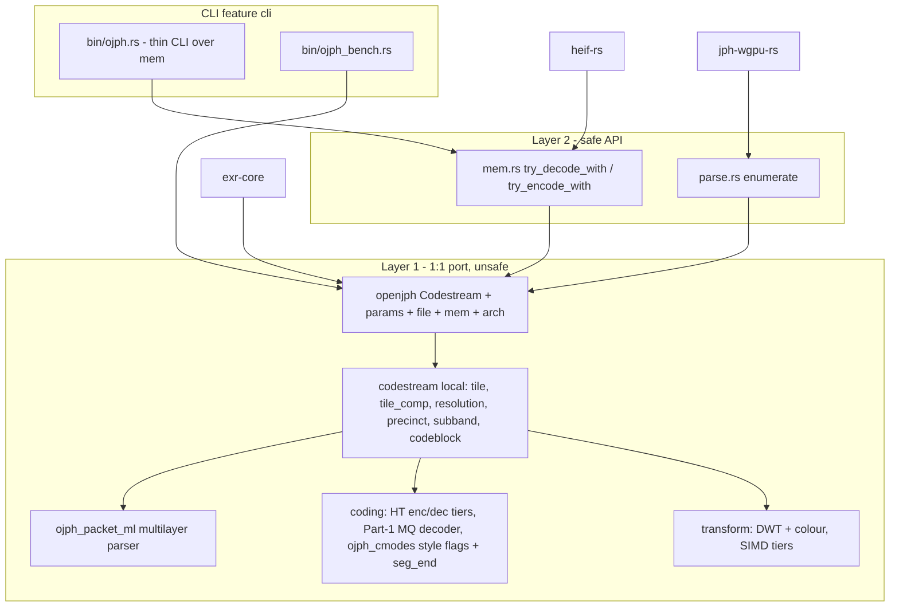
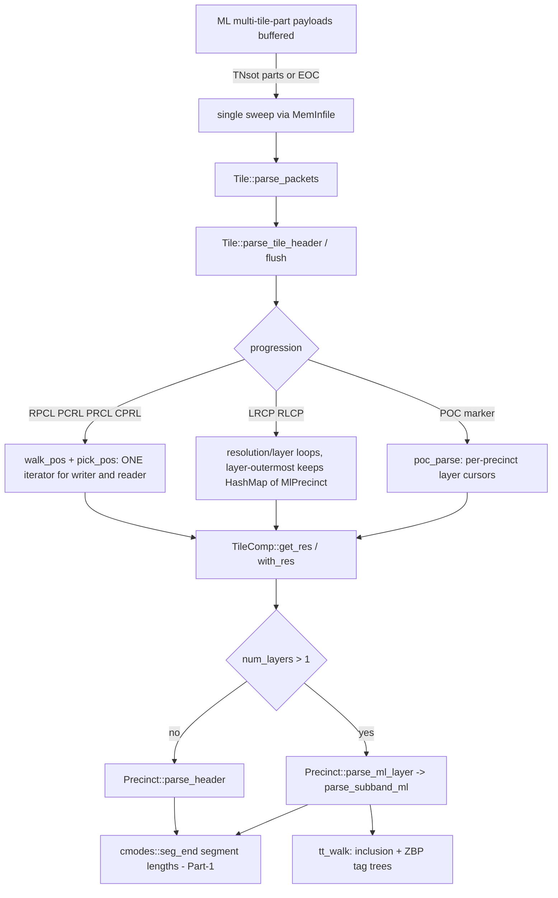
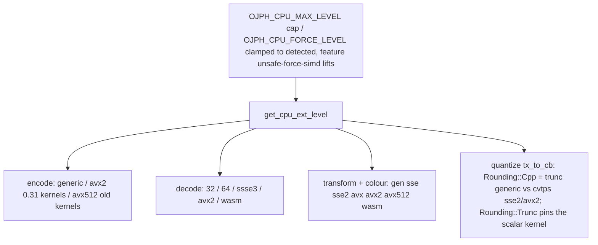
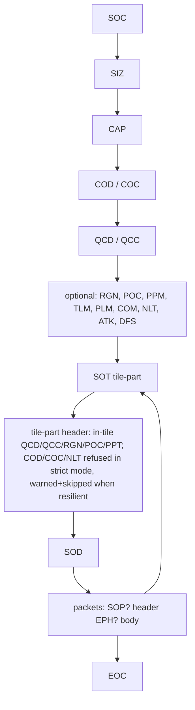
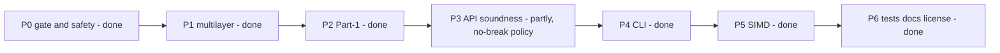

# Diagrams - jph-rs (refreshed 2026-09-30, see AGENTS.md / plan1.md)

The previous version (parity pie over 47 files, unsourced severity pie and parity percentages) was removed: it did not cover `mem.rs`, `parse.rs`,
the Part-1 decoder or the multilayer path, and its numbers were not sourced.

## Crate layers

## Decode path (untrusted-input gate before any allocation)

```mermaid
flowchart LR
    A[bytes] --> B[MemInfile::open]
    B --> C[read_headers: markers, COD validity]
    C --> R[restrict_input_resolution: reduce vs min per-component decomps]
    R --> E[check_siz: MAX_IMAGE_PIXELS budget]
    E --> D[create: arena alloc scaled by geometry]
    D --> F[alloc plane Vecs]
    F --> G{pull_ref per line}
    G --> H[parse_tile_header: packets]
    H --> I[Codeblock::decode HT or Part-1]
    I --> J[apply_roi RGN per block]
    J --> K[dequant tx_from_cb]
    K --> L[inverse DWT]
    L --> M[inverse colour]
    M --> N[Plane.samples]
    style E fill:#9f9
```

`parse::enumerate` runs the same `check_siz` gate. Green = the gate (plan1 H1, fixed).

## Packet iteration and header parsing (shared pieces)

Dropped (reduced) resolutions: the headers are parsed, bodies stepped over (`skipped_res_for_read`).

## SIMD dispatch

## Codestream structure

## Bug hunt status (source: plan1.md, AGENTS.md ledger)

Conformance: 73/73 ISO vectors (`tests/conf_ref.rs`). Open items are listed in AGENTS.md.
